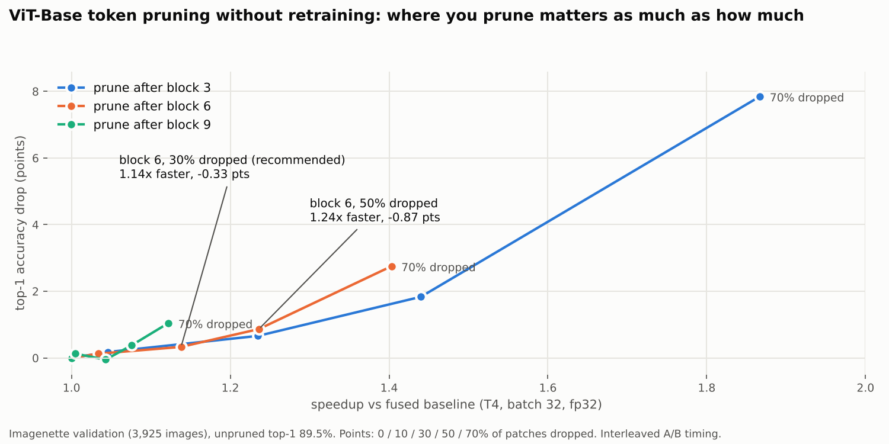
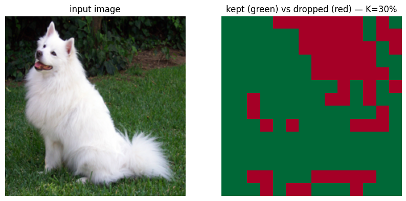

# Training-Free Token Pruning for ViT-Base

A pretrained **ViT-Base** (`vit_base_patch16_224`, timm) skips its least-informative image patches
**without any retraining**: a middle block's own **CLS-token attention** scores the 196 patches, the
lowest-scoring ones are dropped, and the remaining blocks run on the shorter sequence.

**Headline (Imagenette, T4, batch 32):** dropping 30% of patches after block 6 gives a **1.14× speedup
for 0.33 points of top-1** (89.5% → 89.1%, 98.8% of predictions unchanged); dropping 50% gives
**1.24× for 0.87 points**. Profiling shows **linear layers, not attention, take ~84% of GPU time** at this
sequence length, which is why shortening the sequence pays off.



## How it works

1. **Expose attention.** timm's fused `scaled_dot_product_attention` never materializes the attention
   matrix. Setting `fused_attn = False` on one block and hooking the input of its `attn_drop` gives the
   exact post-softmax attention (dropout is a no-op in eval).
2. **Score patches.** Mean over the 12 heads, take the CLS row, drop the CLS-to-CLS entry: one score per
   patch, at no extra compute.
3. **Prune.** `PrunedViT` runs blocks 0..L on all 197 tokens, keeps the top (1 − K) patches (re-sorted into
   their original order so positions stay consistent), and runs blocks L+1..11 on CLS + kept patches.



## Results

Full Imagenette validation set (3,925 images), frozen pretrained 1000-way head, unpruned top-1 89.5%.
T4, fp32, batch 32. Speedup uses **interleaved A/B timing** (baseline and pruned alternate in rounds;
median of per-round ratios), because single-shot T4 timings drifted by ~10%.

| Prune after | Dropped | Top-1 | Δ points | Agreement | GFLOPs / image | Speedup |
|---|---:|---:|---:|---:|---:|---:|
| — (baseline) | 0% | 89.5% | — | 100% | 35.13 | 1.00× |
| block 3 | 30% | 88.8% | −0.66 | 98.1% | 28.08 | 1.24× |
| block 3 | 50% | 87.6% | −1.83 | 95.2% | 23.32 | 1.44× |
| block 3 | 70% | 81.6% | −7.85 | 87.3% | 18.75 | 1.87× |
| **block 6** | **30%** | **89.1%** | **−0.33** | **98.8%** | 30.72 | **1.14×** |
| block 6 | 50% | 88.6% | −0.87 | 96.9% | 27.75 | 1.24× |
| block 6 | 70% | 86.7% | −2.75 | 93.7% | 24.89 | 1.40× |
| block 9 | 30% | 89.5% | +0.05 | 99.5% | 33.37 | 1.04× |
| block 9 | 70% | 88.4% | −1.05 | 97.1% | 31.03 | 1.12× |

**What the numbers say**
- **Where you prune matters as much as how much.** Early pruning (block 3) shortens 8 downstream blocks,
  so it has the highest ceiling, but its attention is a weaker relevance signal and accuracy falls off
  past 50%. Late pruning (block 9) is nearly free but only shortens 2 blocks.
- **The trade-off is not linear.** At block 6, going from 30% to 50% dropped more than doubles the
  accuracy cost (0.33 → 0.87 points) for a smaller speed gain.
- **Linear layers dominate.** `aten::addmm` is ~84% of CUDA time and attention ~10%: at N = 197, d = 768,
  the N·d² linear terms outweigh N²·d attention. Pruning still helps because every linear layer
  downstream also shrinks with N (profiled CUDA time 386 → 326 ms at 50% dropped).
- **The speedup needs a compute-bound batch.** At batch 32, speedup tracks the FLOP reduction; at
  batch 1 it is noisy and roughly flat (0.90–1.20×), because the T4 is bound by kernel-launch overhead
  (~2.3 TFLOP/s effective). Single-frame, latency-bound use would need CUDA graphs or TensorRT on top.

## Correctness checks

- At 0% dropped, the wrapper matches the fused baseline to a max logit difference of ~1.4e-6.
- The gather path is tested separately (keeping all 196 patches through it is an exact identity), since
  K = 0 skips it.
- Sequence length after block 6 is checked directly: 197 / 178 / 139 / 99 tokens at 0 / 10 / 30 / 50%.

## Exploratory: does LoRA recover the lost accuracy?

LoRA (r=8) on blocks 7–11, trained at block 6 / 50% dropped, then merged into the weights (no speed
cost: 1.236× after merging). A naive before/after shows "+11 points", but that compares a model
fine-tuned on Imagenette's 10 classes with the frozen zero-shot classifier. A **control run** trains
the same recipe without pruning and is evaluated under the same 50% pruning:

| LoRA training | Evaluated at 50% dropped |
|---|---:|
| "with" 50% dropped (notebook 03) | 99.59% |
| without pruning (control, notebook 04) | 99.62% |

**No pruning-specific benefit was observed** (−0.03 points): after any fine-tuning, this 10-class task
is easy enough that pruning barely matters (the control loses 0.13 points when pruning is switched on).
One caveat makes the test weaker than intended: the evidence in notebook 03 (pre-training accuracy
equal to the unpruned model, epochs no faster than the control's) suggests pruning was not active while
that run trained. The fix and re-run are listed in Next steps.

## Repository layout

```
notebooks/
  01_scoring_and_wrapper.ipynb          # attention hook, CLS scoring, PrunedViT, correctness (CPU is enough)
  02_benchmark_and_sweep.ipynb          # FLOPs, latency, profiler, full 3 x 4 sweep on the val set (T4)
  03_lora_recovery_exploratory.ipynb    # LoRA on post-prune blocks trained at 50% dropped, merged (T4)
  04_lora_control.ipynb                 # control: same LoRA trained without pruning, evaluated pruned (T4)
assets/                                 # figures used in this README
requirements.txt
```

## Limitations and next steps

- **No random-pruning baseline yet**, so it is not separated how much comes from attention-based
  scoring versus simply running a shorter sequence. This is the most important missing control.
- One GPU (T4) in fp32; fp16/bf16 with tensor cores would change the baseline and the batch-1 picture.
- Blocks 3, 6 and 9 only; fixed drop rates; a 10-class evaluation set.
- Next: assert the post-block-6 sequence length inside the LoRA training loop and re-run it, ideally at block 3 / 70%
  where the frozen gap (7.85 points) leaves room for an effect; random-pruning control, `torch.compile` / CUDA graphs at batch 1, fp16, blocks 4–8, full
  ImageNet-1k, and combining pruning with INT8 quantization.

## Tech

PyTorch · timm · torch.profiler · FlopCounterMode · CUDA events · peft (LoRA)

## Related

- [TensorRT-Quantization-ImageClassification](https://github.com/namrathasanjay/TensorRT-Quantization-ImageClassification):
  INT8 PTQ / QAT for CNNs with TensorRT.
- [phi2-fp8-quantization-vllm](https://github.com/namrathasanjay/phi2-fp8-quantization-vllm) and
  [qwen2.5-7b-fp8-serving](https://github.com/namrathasanjay/qwen2.5-7b-fp8-serving): FP8 for LLM inference.
